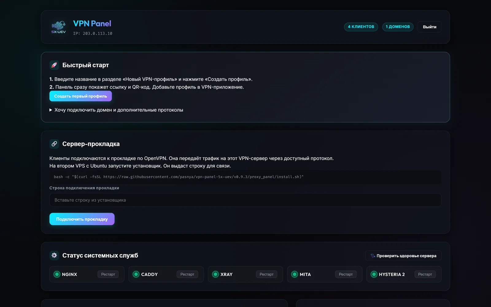
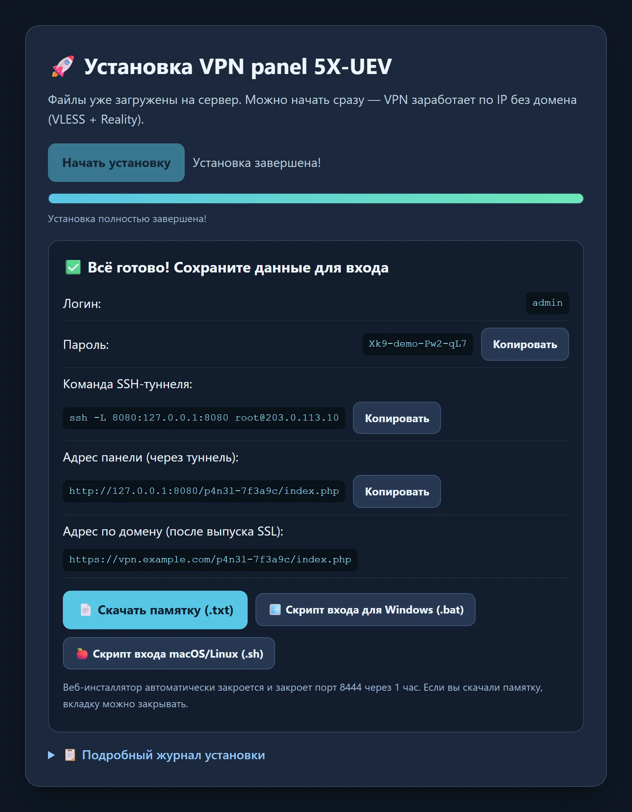
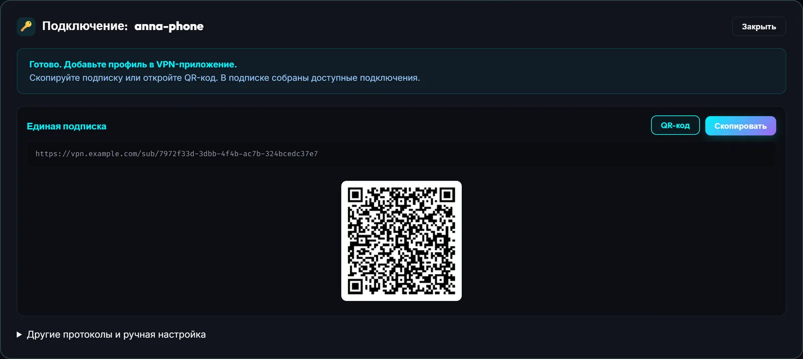
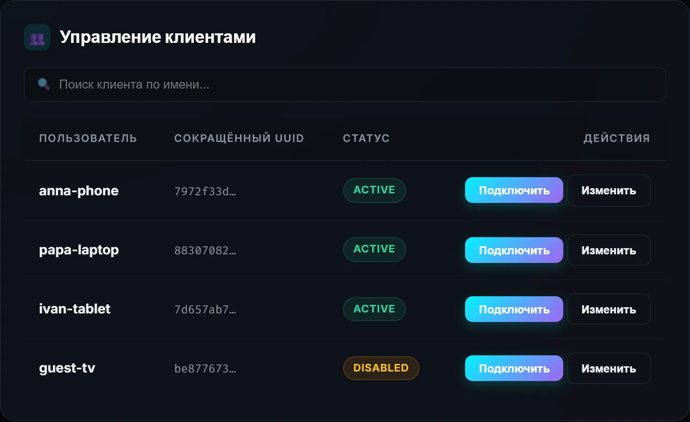
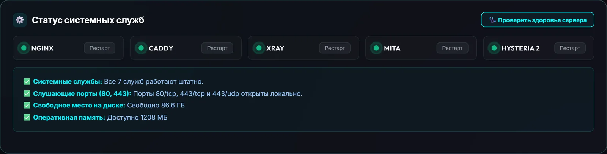

<p align="center">
  
</p>

# 🚀 VPN panel 5X-UEV

[Русский](README.md) · [English](README.en.md) · [Documentation & Guides](https://pasnya.github.io/vpn-panel-5x-uev/)

[](LICENSE)
[](https://github.com/pasnya/vpn-panel-5x-uev/releases)

**VPN panel 5X-UEV** is a self-hosted VPN & proxy control panel for Ubuntu so simple that even your mom can install it - yes, the one who still keeps passwords on a sticky note under the monitor. No Linux skills required: we already suffered so you don't have to. Install everything from a guided browser installer with automatic `UFW` and `swap` setup, create your first **VLESS + Reality** profile in seconds without a domain, and run **5 protocols on port 443** simultaneously.

Need a cascade / relay setup? Deploy the **OpenVPN Relay** module on a second VPS and pair it with one string: clients connect via standard OpenVPN to the relay, and the relay forwards traffic over an active **Reality** or **xHTTP** tunnel to your main server.

---

## 🖼️ Screenshots

<p align="center">
  
</p>

| Browser installer | Profile with QR code |
|---|---|
|  |  |
| **Clients** | **Server health** |
|  |  |

Client names, domain and IP in the screenshots are demo data. The interface is in Russian; more screens are on the [docs site](https://pasnya.github.io/vpn-panel-5x-uev/#screenshots).

---

## ✨ Key Features

* **Browser-Based Installer**: Step-by-step progress bar, optional domain & DNS pre-check, downloadable `.txt` credentials and one-click `.bat` / `.sh` SSH tunnel launchers.
* **5 Protocols on Port 443**:
  * `VLESS + Reality` (default, works by IP without a domain).
  * `VLESS + xHTTP` (HTTPS transport with domain).
  * `NaiveProxy` (via Caddy `forwardproxy`).
  * `Hysteria 2` (UDP/QUIC with port hopping `20000:50000/udp`).
  * `Mita (Mieru)` (TCP multiplexing).
* **OpenVPN Cascade Relay**: Separate relay server panel that bridges OpenVPN clients to your main server via Reality or xHTTP with automatic failover.
* **Cloudflare WARP Integration**: One-click WARP registration with Smart (OpenAI/Netflix/ipify) or Global routing modes.
* **Automatic SSL & Decoy Sites**: Let's Encrypt certificates via Certbot, DNS pre-flight check, and decoy templates (`blog`, `portfolio`, `landing`).
* **Built-in Server Health Diagnostics**: Check all 7 system services, listening ports (`80/tcp`, `443/tcp`, `443/udp`), disk, and memory from the dashboard.

---

## 💻 Requirements

* **OS**: Ubuntu 20.04 / 22.04 / 24.04 (clean server recommended)
* **Arch**: `x86_64` (AMD64) on 20.04/22.04/24.04; `arm64` on 22.04/24.04
* **Access**: `root` (or `sudo`)
* **Network**: Public IPv4, ports `80` and `443` open

---

## 🛠️ Quick Installation

Run the bootstrap command on a fresh Ubuntu server:

```bash
bash -c "$(curl -fsSL https://raw.githubusercontent.com/pasnya/vpn-panel-5x-uev/v0.9.6/install.sh)"
```

Open the printed `https://SERVER_IP:8444/?token=...` link in your browser and click **Start Installation**.

For zero-touch console installation without the browser UI:

```bash
bash -c "$(curl -fsSL https://raw.githubusercontent.com/pasnya/vpn-panel-5x-uev/v0.9.6/install.sh)" -- --auto
```

### Relay Server (Optional Second VPS)

**"Does OpenVPN even work?"** It does, with a catch: from Russia, OpenVPN connections to **foreign** servers are often unstable - they may not connect or keep dropping. OpenVPN to a server **inside Russia** is stable. So the relay goes on a Russian VPS: devices connect to it with a plain OpenVPN file, and the relay carries the traffic across the border to your main server over Reality or xHTTP.

```
Device (.ovpn) --OpenVPN, inside Russia--> Relay in Russia --Reality / xHTTP across the border--> Main server abroad --> Internet
```

* **Direct to the main server abroad**: VLESS Reality, xHTTP, Hysteria 2, NaiveProxy or Mieru, with any app that supports the chosen protocol. OpenVPN is never used for the main server.
* **Through the relay**: any OpenVPN client, including routers. Only TCP and DNS pass through the relay, so use direct Reality or Hysteria 2 profiles for UDP games and calls.

Run on a clean Ubuntu 20.04 / 22.04 / 24.04 VPS in Russia (x86_64 or ARM64):

```bash
bash -c "$(curl -fsSL https://raw.githubusercontent.com/pasnya/vpn-panel-5x-uev/v0.9.6/proxy_panel/install.sh)"
```

Paste the generated pairing string into the **Relay Server** section of the main panel.

---

## 🌀 Why Cloudflare WARP?

Short answer: so picky websites stop side-eyeing your server.

Your VPS lives in a data center, and its IP looks like a data-center IP. Some services - ChatGPT, Netflix and other divas - don't love that: CAPTCHAs, a trimmed catalog, or a polite "not today". Your server did nothing wrong; it just has a data-center face.

**Cloudflare WARP** is Cloudflare's free network. The panel connects your server to it, so requests to those picky sites leave through Cloudflare and the site sees a Cloudflare IP instead of your VPS.

* **Smart mode** (default) - only OpenAI, Netflix and ipify (to check your IP) go through WARP; everything else goes direct and fast.
* **Global mode** - all outgoing server traffic goes through WARP.

It's one button in the panel - no keys, no accounts, no sign-ups. If everything already works for you, leave it alone. The best setting is the one you never had to touch.

---

## 📱 Recommended Clients

* **Windows / Android**: [Anarise VPN](https://github.com/pasnya/anarise-vpn)
* **iOS**: Shadowrocket, Streisand, Sing-box
* **macOS**: Nekoray / Nekobox, Sing-box
