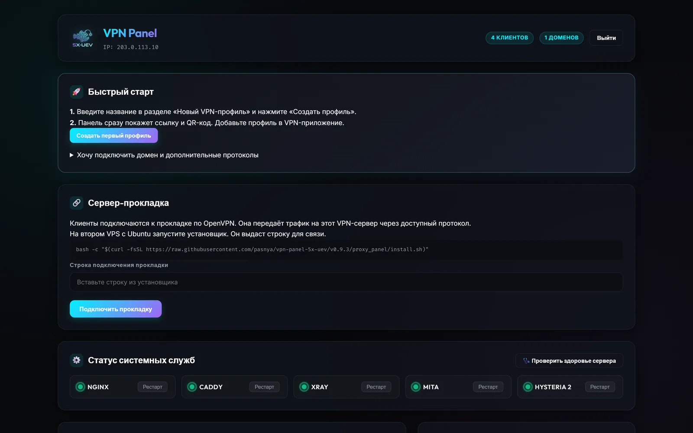
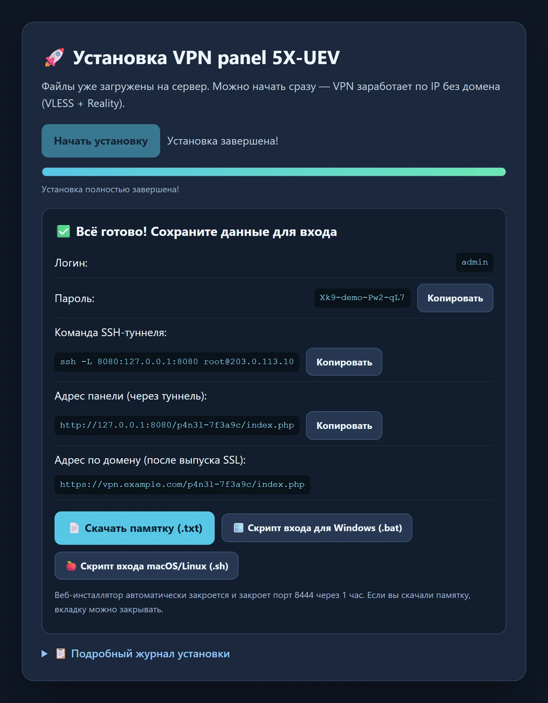
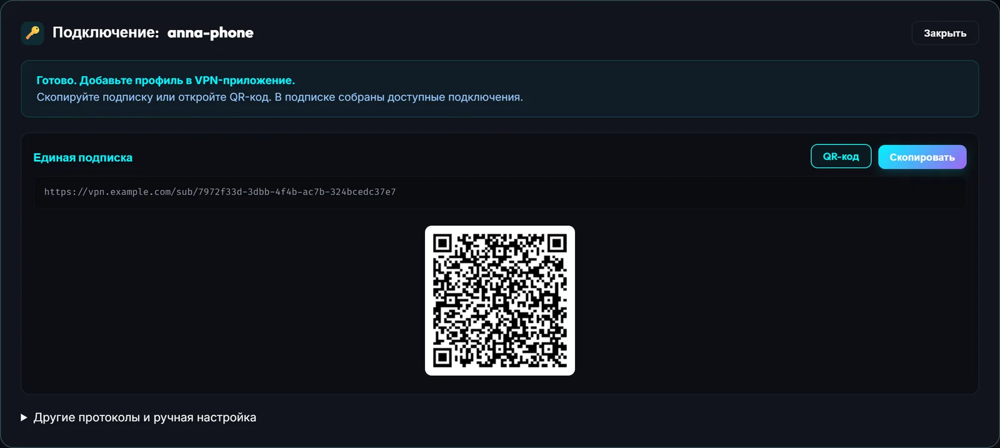
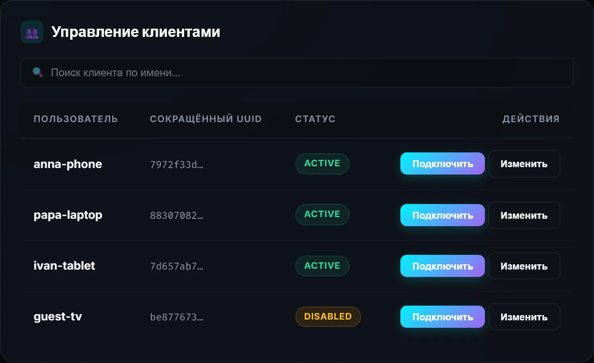
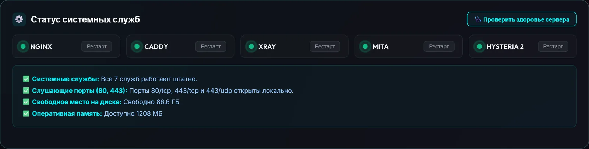

<p align="center">
  
</p>

# 🚀 VPN panel 5X-UEV
### *«Ты бы сделал лучше, но пришлось делать мне»*

[Русский](README.md) · [English](README.en.md) · [Документация и гайды](https://pasnya.github.io/vpn-panel-5x-uev/)

[](LICENSE)
[](https://github.com/pasnya/vpn-panel-5x-uev/releases)
[](https://t.me/)

**VPN panel 5X-UEV** - веб-панель для личного VPN-сервера на Ubuntu, которую поставит даже твоя мама. Да, та самая, что до сих пор хранит пароли на стикере под монитором. Опыт в Linux не нужен: мы набили все шишки за вас. Установка проходит через браузер с пошаговым прогресс-баром, автоматической настройкой файрвола (`UFW`) и swap, а первый профиль **VLESS + Reality** создаётся по одному имени и работает сразу по IP **без домена**.

Если нужен каскадный VPN или стабильная связь с зарубежным сервером там, где прямое подключение работает с перебоями, подключите **сервер-прокладку** на втором VPS в России одной строкой: клиент подключается к прокладке по стандартному **OpenVPN**, а она автоматически передаёт трафик на основной сервер через работающий канал **Reality** или **xHTTP**. Все 5 протоколов (**VLESS Reality**, **VLESS xHTTP**, **Hysteria 2**, **NaiveProxy**, **Mita/Mieru**) и **Cloudflare WARP** работают одновременно на одном порту `443`.

---

## 🤷 Для кого это

*   Для тех, кто слышал слово «сервер» только в контексте «сервер упал».
*   Для тех, кто три вечера читал гайды про Xray и понял только слово «Xray».
*   Для тех, у кого вся семья просит «настроить нормальный VPN», а желания разбираться - ноль.
*   **Не** для тех, кто продаёт VPN на тысячу человек: вам в [Marzban или Remnawave](https://pasnya.github.io/vpn-panel-5x-uev/compare.html), мы не обидимся.

Если вы умеете копировать и вставлять текст - вы уже квалифицированы. Других требований к пользователю нет. Мы проверяли.

---

## 🖼️ Скриншоты

<p align="center">
  
</p>

| Установка в браузере | Профиль с QR-кодом |
|---|---|
|  |  |
| **Клиенты** | **Здоровье сервера** |
|  |  |

Имена клиентов, домен и IP на скриншотах - демонстрационные. Больше экранов - на [сайте документации](https://pasnya.github.io/vpn-panel-5x-uev/#screenshots).

---

## ✨ Ключевые преимущества

*   **Режим одного окна**: Управление статусом системных служб, клиентами, доменами и ядрами протоколов собрано на одном лаконичном экране.
*   **Мультипротокольность**: Доступны несколько способов подключения:
    *   `VLESS + Reality` (по умолчанию, не требует домена, работает по IP-адресу).
    *   `VLESS + xHTTP` (подключение через HTTPS при наличии домена).
    *   `NaiveProxy` (работает через веб-сервер Caddy).
    *   `Hysteria 2` (подключение на базе UDP/QUIC).
    *   `Mita (Mieru)` (подключение по TCP).
*   **Автоматический выпуск SSL-сертификатов**: Панель сама запрашивает бесплатные сертификаты Let's Encrypt через Certbot при привязке домена.
*   **Быстрый старт**: Первый профиль создаётся по одному названию. Домен можно подключить позже для дополнительных протоколов.
*   **Отдельная прокладка**: Установите OpenVPN на втором VPS, свяжите панели одной строкой и скачивайте готовые профили. Прокладка переключается между доступными каналами Reality и xHTTP.
*   **Встроенные QR-коды**: Генерируйте QR-коды для быстрого импорта конфигурационных ссылок в мобильные приложения.
*   **Встроенный BBR & Sysctl**: Автоматическая оптимизация сетевых настроек ядра Linux и BBR для снижения пинга и ускорения передачи данных.
*   **Элегантный темный дизайн**: Премиальный веб-интерфейс с использованием стеклянного эффекта (glassmorphism), плавных переходов и интуитивно понятных элементов управления.

---

## 💻 Системные требования

*   **ОС**: Ubuntu 20.04 / 22.04 / 24.04 (рекомендуется чистая система)
*   **Архитектура**: x86_64 (AMD64) для Ubuntu 20.04/22.04/24.04; ARM64 для Ubuntu 22.04/24.04
*   **Права**: Доступ к пользователю `root` (или sudo)
*   **Сеть**: Открытые порты 80 и 443. Внешний IPv4-адрес.
*   **Знание Linux**: не требуется. Вообще. Даже знание того, что такое Linux.
*   **Руки**: желательно две, но и одной хватит - тут всего одна команда.

---

## 🛠️ Установка через браузер

Вся установка - это одна строка в консоли и одна кнопка в браузере. Если вы ждали чего-то сложнее - простите, что разочаровали.

**Где вводить команду?** Хостер после оплаты VPS пришлёт IP и пароль root. На Windows откройте PowerShell (Пуск → `PowerShell`), на macOS - «Терминал», и введите `ssh root@IP_СЕРВЕРА`, затем пароль. Пароль при вводе не отображается - это не сломалось, так и задумано. Вставьте команду ниже и нажмите Enter. Поздравляем, вы только что администрировали Linux.

Команда скачает установочные файлы и покажет ссылку на временный веб-инсталлятор. Установка служб начнётся только после нажатия кнопки в браузере.

```bash
bash -c "$(curl -fsSL https://raw.githubusercontent.com/pasnya/vpn-panel-5x-uev/v0.9.5/install.sh)"
```

Откройте выданную ссылку `https://IP_СЕРВЕРА:8444/?token=…`, при желании укажите домен и нажмите **«Начать установку»**. Установщик сам откроет порт `8444/tcp` в `ufw` (если файрвол включён) и закроет его после завершения, а также создаст `swap` при нехватке RAM. У временного веб-инсталлятора самоподписанный сертификат, поэтому браузер покажет предупреждение. Нет, вас не взламывают: нажмите «Дополнительно» → «Перейти на сайт». Браузер просто нервный. Ссылка содержит секретный ключ - не передавайте её посторонним.

Для установки без браузера одной командой добавьте флаг `--auto`:
```bash
bash -c "$(curl -fsSL https://raw.githubusercontent.com/pasnya/vpn-panel-5x-uev/v0.9.5/install.sh)" -- --auto
```

### После завершения установки веб-инсталлятор покажет:
1.  **Готовую карточку доступов** с кнопками копирования, скачивания памятки `.txt` и готовых скриптов запуска SSH-туннеля (`open-panel-windows.bat` / `open-panel-mac-linux.sh`).
2.  **Секретный URL** для входа в панель (публичный HTTP-порт админки не открывается; после привязки домена доступен HTTPS-адрес).
3.  **Логин и пароль администратора** (`admin` и случайный пароль - сохраните его и смените в панели).

---

## 🌀 Зачем нужен Cloudflare WARP

Коротко: чтобы капризные сайты не косились на ваш сервер.

Ваш VPS живёт в дата-центре, и его IP для сайтов выглядит как IP дата-центра. Некоторые сервисы - ChatGPT, Netflix и прочие привереды - такое не любят: показывают капчу, урезают каталог или говорят «не сегодня». Сервер не виноват, просто у него лицо дата-центра.

**Cloudflare WARP** - бесплатная сеть Cloudflare. Панель подключает к ней сервер, и запросы к привередливым сайтам уходят через Cloudflare: сайт видит IP Cloudflare вместо IP вашего VPS и успокаивается.

*   **Умный режим (Smart)** - через WARP идут только OpenAI, Netflix и ipify (чтобы проверить свой IP), остальное напрямую и быстро. Выбран по умолчанию, и не зря.
*   **Глобальный режим (Global)** - весь исходящий трафик сервера через WARP.

Включается одной кнопкой «Подключить Cloudflare WARP» в панели: без ключей, аккаунтов и регистраций. Если у вас и так всё открывается - не трогайте. Лучшая настройка - та, которую не пришлось делать.

---

## ⚖️ Сравнение с альтернативами

| Возможность | VPN panel 5X-UEV | 3x-ui | Ручная настройка |
| :--- | :---: | :---: | :---: |
| Установка через браузер с прогресс-баром | ✅ | ❌ | ❌ |
| Работа без домена сразу после установки (Reality) | ✅ | ⚙️ вручную | ⚙️ вручную |
| Все протоколы на одном 443 порту (Reality, xHTTP, Hysteria 2, NaiveProxy, Mieru) | ✅ | Только Xray | ⚙️ сложно |
| Готовый сервер-прокладка (OpenVPN → Reality/xHTTP) | ✅ в 1 строку | ❌ | ⚙️ очень сложно |
| Встроенный Cloudflare WARP (Smart / Global) | ✅ в 1 клик | ⚙️ вручную | ⚙️ вручную |
| Pre-flight проверка DNS и диагностика служб в панели | ✅ | ❌ | ❌ |
| Скрипты входа `.bat` / `.sh` для новичков | ✅ | ❌ | ❌ |

---

## 📖 Быстрый старт

После входа в панель введите название в разделе «Новый VPN-профиль» (например, «мама-телефон» - для неё же всё и делалось) и нажмите «Создать профиль». Панель откроет ссылку Reality и QR-код для подключения. Домен для первого профиля не требуется.

Если нужны остальные протоколы, создайте A-записи домена и поддомена на IP сервера, затем добавьте домен в панели. После выпуска сертификата новые профили будут автоматически привязаны к готовому домену; основным действием станет копирование единой подписки. Отдельные ссылки протоколов доступны в раскрываемом разделе «Другие протоколы и ручная настройка».

### Подключение сервера-прокладки

**«Но OpenVPN же блокируют!»** Да. OpenVPN до **зарубежных** серверов в России, как правило, не работает: протокол слишком узнаваемый. Но до сервера **в России** он работает спокойно. Поэтому прокладка ставится на российский VPS: устройство подключается к ней по обычному OpenVPN, а через границу прокладка сама везёт трафик на основной сервер по Reality или xHTTP. Устройство про заграницу вообще ничего не знает.

```
Устройство (.ovpn) --OpenVPN, внутри РФ--> Прокладка в России --Reality / xHTTP через границу--> Основной сервер за границей --> Интернет
```

| | Напрямую к основному серверу | Через прокладку |
|---|---|---|
| Куда подключается устройство | К основному серверу за границей | К прокладке в России |
| Протокол | VLESS Reality, xHTTP, Hysteria 2, NaiveProxy или Mieru | OpenVPN (`.ovpn`) |
| Чем подключаться | Любым приложением с поддержкой выбранного протокола | Любым клиентом OpenVPN, включая роутеры |
| Игры и звонки по UDP | Работают | Нет: через прокладку идут TCP и DNS |
| Кому подходит | Телефоны и компьютеры, куда можно поставить приложение | Роутеры, рабочие компьютеры, родственники, которым проще открыть один файл |

К основному зарубежному серверу OpenVPN не используется вообще: туда подключаются напрямую любым клиентом выбранного протокола. OpenVPN-файл из панели всегда ведёт на прокладку.

На втором чистом VPS **в России** (Ubuntu 20.04 / 22.04 / 24.04, x86_64 или ARM64) запустите отдельный установщик:

```bash
bash -c "$(curl -fsSL https://raw.githubusercontent.com/pasnya/vpn-panel-5x-uev/v0.9.5/proxy_panel/install.sh)"
```

Установщик выведет пароль панели прокладки и строку подключения. Вставьте строку в разделе «Сервер-прокладка» основной панели. После связки обычные профили получают кнопку скачивания OpenVPN-файла. Пользователь подключается по OpenVPN к прокладке, а она выбирает доступный канал Reality или xHTTP до основного сервера. Для xHTTP нужен активный домен; Reality работает по IP. При отказе обоих каналов прокладка не выпускает трафик напрямую в интернет.

Для прокладки должны быть доступны входящие порты `51820/udp` (OpenVPN) и `8443/tcp` (панель). Администратор может открыть панель прокладки по HTTPS на порту 8443. Строку связки и пароль сохраните сразу после установки.

В этой версии прозрачная маршрутизация на прокладке поддерживает TCP и DNS. Остальной UDP блокируется, чтобы трафик не обходил основной сервер. Приложения, которым нужен UDP, могут не работать через OpenVPN-прокладку. Прямые профили основных протоколов остаются доступны в панели.

Клиентов можно отключать и ограничивать по сроку действия. Учёт трафика сейчас собирается из Xray; трафик NaiveProxy, Hysteria 2 и Mieru в лимит не включён. Резервную копию можно скачать и восстановить через панель **на той же установке**; архив содержит секретные ключи и пароли.

---

## 📱 Поддерживаемые клиенты

*   **Windows**: **[Anarise VPN](https://github.com/pasnya/anarise-vpn)** (Рекомендуется - поддержка всех протоколов панели)
*   **Android**: **[Anarise VPN](https://github.com/pasnya/anarise-vpn)** (Рекомендуется - поддержка всех протоколов панели)
*   **iOS (iPhone)**: [Shadowrocket](https://apps.apple.com/us/app/shadowrocket/id932747118), [Streisand](https://apps.apple.com/ru/app/streisand/id6450534064), [Sing-box](https://apps.apple.com/us/app/sing-box/id6448301546)
*   **macOS**: [Nekoray / Nekobox](https://github.com/MatsuriDayo/nekoray), [Sing-box](https://github.com/SagerNet/sing-box)
*   **Через прокладку (OpenVPN)**: любой клиент OpenVPN на любой платформе, включая роутеры. Файл `.ovpn` работает только с прокладкой в России, к основному зарубежному серверу подключайтесь приложениями выше.

---

## 🔒 Безопасность и приватность

Панель защищает сервер и ваш трафик от посторонних глаз:
*   Подключение выглядит как обычное посещение HTTPS-сайта на вашем домене.
*   Посторонние посетители и автоматические сканеры видят обычный сайт-заглушку (блог, лендинг или портфолио) с кодом 403/404.
*   Админка защищена случайно сгенерированным секретным префиксом в URL-адресе.

## 🗑️ Полное удаление панели

Если вам необходимо полностью удалить все установленные прокси-службы, веб-панель управления и сбросить настройки сети (с сохранением SSL-сертификатов Let's Encrypt для возможности повторной установки), выполните команду:

```bash
bash -c "$(curl -fsSL https://raw.githubusercontent.com/pasnya/vpn-panel-5x-uev/main/cleanup.sh)"
```

---

*Разработано с заботой о приватности в интернете и о нервах тех, кому «просто настроить VPN» попросили родственники.* 🌐
